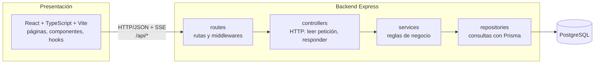

# Arquitectura

## Capas



| Capa | Carpeta | Responsabilidad | No hace |
|---|---|---|---|
| Presentación | `frontend/src` | Interfaz, validación de formularios, llamadas a la API | Decidir reglas de negocio; hablar con la base de datos |
| API | `backend/src/routes`, `controllers`, `middlewares`, `validators` | Rutas, autenticación, autorización por rol, validación de entrada, formato de respuesta | Lógica de negocio |
| Negocio | `backend/src/services` | Transiciones de estado, asignación, plazos, auditoría, notificaciones | Conocer `req`/`res`; escribir SQL |
| Acceso a datos | `backend/src/repositories` | Consultas y transacciones con Prisma | Decidir permisos o reglas |
| Persistencia | PostgreSQL | Claves, restricciones, índices, trigger de historial inmutable | – |

Una petición recorre siempre: `route → middlewares (auth, rol, validación) → controller → service → repository → BD`. Los errores se lanzan como `AppError(status, code, message)` y los convierte en JSON un único `errorHandler`.

## Estructura del repositorio

```
servigest/
├─ backend/
│  ├─ prisma/            schema.prisma, migrations/, seed.js
│  ├─ src/
│  │  ├─ app.js          crea la app Express (sin escuchar puerto; así se prueba con Supertest)
│  │  ├─ server.js       arranca el servidor
│  │  ├─ config/         lectura y validación de variables de entorno
│  │  ├─ routes/
│  │  ├─ controllers/
│  │  ├─ services/
│  │  ├─ repositories/
│  │  ├─ middlewares/    auth, requireRole, validate, errorHandler
│  │  ├─ validators/     esquemas Zod
│  │  └─ utils/          AppError, paginación
│  └─ tests/             unit/, integration/, helpers/
├─ frontend/
│  ├─ src/
│  │  ├─ pages/          una carpeta por pantalla
│  │  ├─ components/     layout/, datos/, dominio/, dashboard/, formularios/
│  │  ├─ hooks/
│  │  ├─ api/            cliente HTTP y funciones por recurso
│  │  └─ routes/         definición de rutas y ProtectedRoute
│  └─ e2e/               pruebas Playwright
├─ docs/
├─ docker-compose.yml    PostgreSQL de desarrollo y de pruebas
└─ .github/workflows/    CI
```

## Stack y justificación

| Elección | Alternativa descartada | Por qué |
|---|---|---|
| **Express** | NestJS | Menos conceptos (sin decoradores ni inyección de dependencias); las capas quedan a la vista y cualquier integrante puede modificarlas en la defensa |
| **PostgreSQL** | MySQL, SQL Server | Tipos y restricciones `CHECK` sólidos, triggers sencillos para el historial inmutable, gratis en la mayoría de servicios de despliegue |
| **Prisma** | SQL a mano, Knex | Migraciones versionadas y datos semilla reproducibles (exigido), transacciones simples, consultas tipadas |
| **JWT** en cabecera `Authorization` | Sesiones en servidor | Sin estado en el servidor; simple de probar y desplegar |
| **bcrypt** | – | Hash seguro estándar para contraseñas |
| **Zod** | Validación manual | Un esquema por endpoint; errores uniformes con detalle por campo |
| **SSE** (Server-Sent Events) | WebSocket / Socket.IO | Las notificaciones solo van del servidor al cliente; SSE es HTTP normal, sin librería extra y con reconexión automática del navegador |
| **React + Vite + React Router** | Next.js | El enunciado pide React con API separada; no se necesita renderizado en servidor |
| **TypeScript (solo frontend)** | JavaScript en todo | shadcn/ui se distribuye en TypeScript y los tipos detectan errores al consumir la API; el backend sigue en JavaScript para no agregar un paso de compilación |
| **shadcn/ui + Tailwind CSS** | MUI, Bootstrap, CSS a mano | Componentes accesibles (Radix) cuyo código queda en el repositorio (`components/ui/`), por lo que se puede leer, modificar y explicar en la defensa |
| **react-hook-form + Zod** | Formularios controlados a mano | Validación declarativa y menos renders |
| **Vitest + Supertest + Playwright** | Jest, Cypress | Vitest sirve igual para backend y frontend; Supertest prueba la API sin levantar puerto; Playwright cubre los dos flujos E2E |
| **swagger-ui-express** con `openapi.yaml` | Generar desde comentarios | Un solo archivo de contrato, revisable en PR |
| **Monorepo** | Dos repositorios | Un solo historial de Git para verificar aportes, una sola CI, documentación en un lugar |

## Ambientes

| Ambiente | Base de datos | Configuración |
|---|---|---|
| Desarrollo | `db` de docker-compose (puerto 5432) | `backend/.env` |
| Pruebas | `db_test` de docker-compose (puerto 5433) o servicio de CI | `backend/.env.test` |
| Producción | Servicio gestionado | Variables del proveedor de despliegue |

Los archivos `.env` no se suben a Git; `.env.example` documenta cada variable.
