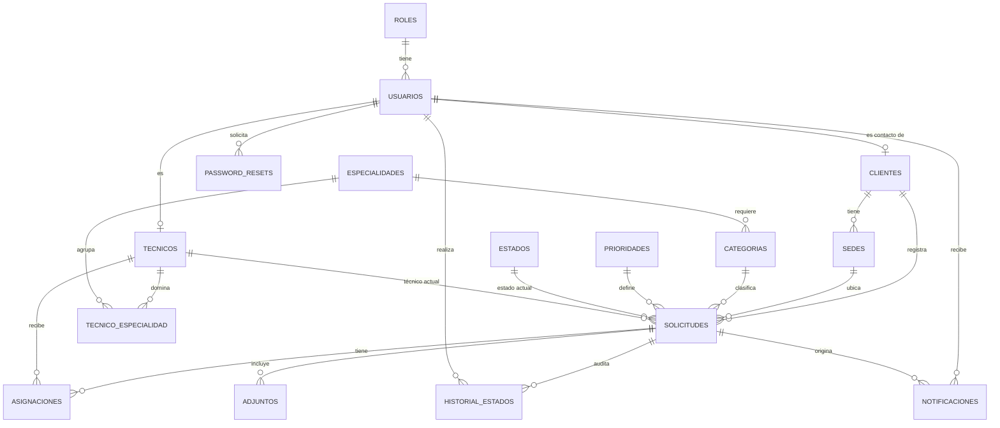

# Modelo de datos

## Modelo lógico

## Modelo físico

Convenciones: nombres en `snake_case`; PK `id` entera autoincremental; fechas `timestamptz`; todas las FK con `ON DELETE RESTRICT` (no se borra lo que está en uso); los catálogos tienen `activo boolean` para manejar la vigencia sin borrar.

### roles
| Columna | Tipo | Restricciones |
|---|---|---|
| id | serial | PK |
| nombre | varchar(20) | UNIQUE, NOT NULL — `admin`, `coordinador`, `tecnico`, `cliente` |

### usuarios
| Columna | Tipo | Restricciones |
|---|---|---|
| id | serial | PK |
| rol_id | int | FK → roles, NOT NULL |
| nombre | varchar(120) | NOT NULL |
| email | varchar(160) | UNIQUE, NOT NULL (guardado en minúsculas) |
| password_hash | varchar(100) | NOT NULL |
| debe_cambiar_password | boolean | NOT NULL, DEFAULT true. Se apaga al cambiar la contraseña; se enciende si el admin la restablece |
| telefono | varchar(20) | |
| activo | boolean | NOT NULL, DEFAULT true |
| created_at | timestamptz | NOT NULL, DEFAULT now() |

### clientes
| Columna | Tipo | Restricciones |
|---|---|---|
| id | serial | PK |
| usuario_id | int | FK → usuarios, UNIQUE, NOT NULL |
| razon_social | varchar(160) | NOT NULL |
| ruc | char(13) | UNIQUE, NOT NULL, CHECK solo dígitos |
| activo | boolean | NOT NULL, DEFAULT true |

### sedes
| Columna | Tipo | Restricciones |
|---|---|---|
| id | serial | PK |
| cliente_id | int | FK → clientes, NOT NULL |
| nombre | varchar(120) | NOT NULL, UNIQUE (cliente_id, nombre) |
| direccion | varchar(200) | NOT NULL |
| activo | boolean | NOT NULL, DEFAULT true |

### tecnicos
| Columna | Tipo | Restricciones |
|---|---|---|
| id | serial | PK |
| usuario_id | int | FK → usuarios, UNIQUE, NOT NULL |
| disponible | boolean | NOT NULL, DEFAULT true |
| carga_max | int | NOT NULL, DEFAULT 5, CHECK > 0 |

### especialidades
| Columna | Tipo | Restricciones |
|---|---|---|
| id | serial | PK |
| nombre | varchar(80) | UNIQUE, NOT NULL |
| activo | boolean | NOT NULL, DEFAULT true |

### tecnico_especialidad
| Columna | Tipo | Restricciones |
|---|---|---|
| tecnico_id | int | FK → tecnicos |
| especialidad_id | int | FK → especialidades |
| | | PK (tecnico_id, especialidad_id) |

### categorias
| Columna | Tipo | Restricciones |
|---|---|---|
| id | serial | PK |
| nombre | varchar(80) | UNIQUE, NOT NULL |
| especialidad_id | int | FK → especialidades, NOT NULL — especialidad que debe tener el técnico |
| activo | boolean | NOT NULL, DEFAULT true |

### prioridades (parámetros operativos)
| Columna | Tipo | Restricciones |
|---|---|---|
| id | serial | PK |
| nombre | varchar(20) | UNIQUE, NOT NULL — baja, media, alta, crítica |
| horas_sla | int | NOT NULL, CHECK > 0 — plazo de atención |
| activo | boolean | NOT NULL, DEFAULT true |

### estados
| Columna | Tipo | Restricciones |
|---|---|---|
| id | serial | PK |
| codigo | varchar(30) | UNIQUE, NOT NULL — `registrada`, `aprobada`, `asignada`, `en_proceso`, `pendiente_info`, `resuelta`, `cerrada`, `cancelada` |
| nombre | varchar(40) | NOT NULL |
| es_final | boolean | NOT NULL |

### solicitudes
| Columna | Tipo | Restricciones |
|---|---|---|
| id | serial | PK |
| codigo | varchar(20) | UNIQUE, NOT NULL — `SOL-AAAA-NNNNNN` |
| cliente_id | int | FK → clientes, NOT NULL |
| sede_id | int | FK → sedes, NOT NULL |
| categoria_id | int | FK → categorias, NOT NULL |
| prioridad_id | int | FK → prioridades, NOT NULL |
| estado_id | int | FK → estados, NOT NULL |
| tecnico_actual_id | int | FK → tecnicos, NULL |
| creado_por | int | FK → usuarios, NOT NULL |
| equipo | varchar(160) | NOT NULL — equipo o recurso afectado |
| descripcion | text | NOT NULL |
| resolucion | text | NULL |
| fecha_limite | timestamptz | NOT NULL — calculada en el backend |
| created_at | timestamptz | NOT NULL, DEFAULT now() |
| resolved_at | timestamptz | NULL |
| closed_at | timestamptz | NULL |
| version | int | NOT NULL, DEFAULT 1 — control de concurrencia |

Índices: `(estado_id)`, `(cliente_id)`, `(tecnico_actual_id)`, `(fecha_limite)`, `(created_at)`.

### asignaciones
| Columna | Tipo | Restricciones |
|---|---|---|
| id | serial | PK |
| solicitud_id | int | FK → solicitudes, NOT NULL |
| tecnico_id | int | FK → tecnicos, NOT NULL |
| asignado_por | int | FK → usuarios, NOT NULL |
| justificacion | text | NULL en la primera asignación, obligatoria al reasignar |
| activa | boolean | NOT NULL, DEFAULT true |
| created_at | timestamptz | NOT NULL, DEFAULT now() |

Índice único parcial: una sola asignación activa por solicitud (`UNIQUE (solicitud_id) WHERE activa`).

### historial_estados
| Columna | Tipo | Restricciones |
|---|---|---|
| id | serial | PK |
| solicitud_id | int | FK → solicitudes, NOT NULL |
| estado_anterior_id | int | FK → estados, NULL en el registro inicial |
| estado_nuevo_id | int | FK → estados, NOT NULL |
| usuario_id | int | FK → usuarios, NOT NULL |
| comentario | text | NULL |
| created_at | timestamptz | NOT NULL, DEFAULT now() |

**Inalterable**: un trigger `BEFORE UPDATE OR DELETE` lanza una excepción. Solo se permiten inserciones. Índice `(solicitud_id, created_at)`.

### adjuntos
| Columna | Tipo | Restricciones |
|---|---|---|
| id | serial | PK |
| solicitud_id | int | FK → solicitudes, NOT NULL |
| nombre_original | varchar(200) | NOT NULL |
| ruta | varchar(300) | NOT NULL |
| mime | varchar(80) | NOT NULL |
| tamano | int | NOT NULL, CHECK > 0 |
| subido_por | int | FK → usuarios, NOT NULL |
| created_at | timestamptz | NOT NULL, DEFAULT now() |

### notificaciones
| Columna | Tipo | Restricciones |
|---|---|---|
| id | serial | PK |
| usuario_id | int | FK → usuarios, NOT NULL |
| solicitud_id | int | FK → solicitudes, NULL |
| tipo | varchar(30) | NOT NULL — `registro`, `asignacion`, `cambio_estado`, `solicitud_info`, `cierre` |
| mensaje | varchar(300) | NOT NULL |
| leida | boolean | NOT NULL, DEFAULT false |
| created_at | timestamptz | NOT NULL, DEFAULT now() |

Índice `(usuario_id, leida, created_at)`.

### password_resets
| Columna | Tipo | Restricciones |
|---|---|---|
| id | serial | PK |
| usuario_id | int | FK → usuarios, NOT NULL |
| token_hash | char(64) | UNIQUE, NOT NULL — SHA-256 del token |
| expira_at | timestamptz | NOT NULL |
| usado | boolean | NOT NULL, DEFAULT false |

## Reproducibilidad

- Esquema: `backend/prisma/schema.prisma` y `backend/prisma/migrations/` (el trigger y el índice parcial van en SQL dentro de una migración).
- Datos de prueba: `backend/prisma/seed.js` — 4 roles, 8 estados, 4 prioridades, especialidades, categorías, 1 administrador, 2 coordinadores, 5 técnicos, 4 clientes con sedes y unas 40 solicitudes repartidas por estado y fecha para que el dashboard tenga datos.
- Comandos: `npx prisma migrate deploy` y `npx prisma db seed`.
