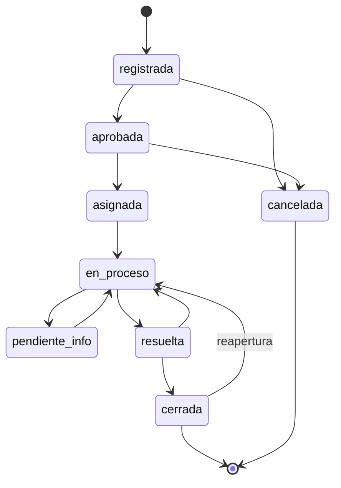

# Estados y reglas de negocio

## Máquina de estados

## Tabla de transiciones

Es la única fuente de verdad. Vive en `backend/src/services/transiciones.js` como un objeto; `solicitudService.cambiarEstado` es el único punto que cambia el estado de una solicitud.

| Desde | Hacia | Roles | Requiere |
|---|---|---|---|
| registrada | aprobada | coordinador | – |
| registrada | cancelada | coordinador, cliente (dueño) | comentario |
| aprobada | asignada | coordinador | solo mediante `POST /asignaciones` |
| aprobada | cancelada | coordinador, cliente (dueño) | comentario |
| asignada | en_proceso | técnico (asignado) | – |
| en_proceso | pendiente_info | técnico (asignado) | comentario |
| pendiente_info | en_proceso | cliente (dueño), coordinador | comentario |
| en_proceso | resuelta | técnico (asignado) | resolución |
| resuelta | cerrada | coordinador | la solicitud tiene resolución |
| resuelta | en_proceso | coordinador | comentario |
| cerrada | en_proceso | coordinador, admin | comentario (reapertura) |

Cualquier otra combinación responde `409 TRANSICION_INVALIDA`. Un rol no permitido responde `403`.

La reasignación no cambia el estado: reemplaza la asignación activa y exige justificación. Se permite en `asignada`, `en_proceso` y `pendiente_info`.

## Plazos (SLA)

Reglas explícitas, calculadas solo en el backend (`backend/src/services/sla.js`, funciones puras):

- `fecha_limite = created_at + prioridad.horas_sla` (horas corridas). Valores iniciales: crítica 4 h, alta 8 h, media 24 h, baja 72 h. Editables por el administrador; el cambio afecta solo a solicitudes nuevas.
- Estado del plazo de una solicitud abierta:
  - `vencida`: ahora > fecha_limite
  - `por_vencer`: queda menos del 20 % del plazo total
  - `a_tiempo`: el resto
- Solicitud resuelta o cerrada: `cumplida` si `resolved_at <= fecha_limite`, si no `incumplida`.
- Las canceladas no cuentan para el cumplimiento.

Decisión: el reloj no se detiene en `pendiente_info`. Es la regla más simple de explicar y de probar; si el docente pide pausarlo, el cambio queda aislado en `sla.js`.

## Asignación

`asignacionService.asignar(solicitudId, tecnicoId, usuario, justificacion)` valida, en este orden:

1. La solicitud existe y está en `aprobada` (asignar) o en `asignada`, `en_proceso`, `pendiente_info` (reasignar).
2. El técnico existe y su usuario está activo.
3. **Especialidad**: el técnico tiene la especialidad de la categoría de la solicitud.
4. **Disponibilidad**: `tecnico.disponible = true`.
5. **Carga**: solicitudes activas del técnico (`asignada`, `en_proceso`, `pendiente_info`) menor que `carga_max`.
6. Si es reasignación: justificación presente y técnico distinto del actual.

Todo dentro de una transacción: desactivar la asignación anterior, crear la nueva, actualizar `tecnico_actual_id` y estado, insertar historial, crear notificaciones.

## Reglas del enunciado → dónde se cumplen → cómo se prueban

| # | Regla | Dónde se valida | Respuesta si falla | Prueba |
|---|---|---|---|---|
| 1 | No cerrar sin resolución documentada | `solicitudService.cambiarEstado` | 422 `RESOLUCION_REQUERIDA` | Unitaria |
| 2 | El técnico solo modifica solicitudes asignadas a él | `solicitudService.cambiarEstado` (compara `tecnico_actual_id`) | 403 | Unitaria + integración |
| 3 | El cliente solo consulta sus registros | `solicitudRepository` filtra por `cliente_id`; el detalle ajeno responde 404 | 404 | Integración |
| 4 | Una cerrada no retrocede sin reapertura autorizada y auditada | Tabla de transiciones: solo `cerrada → en_proceso`, roles coordinador y admin, comentario obligatorio | 403 / 422 | Unitaria |
| 5 | La asignación valida especialidad, disponibilidad y carga | `asignacionService.asignar` | 422 `TECNICO_SIN_ESPECIALIDAD`, `TECNICO_NO_DISPONIBLE`, `TECNICO_CARGA_MAXIMA` | Unitaria (3 casos) |
| 6 | Plazos y cumplimiento calculados en el backend | `sla.js`; la API devuelve `fechaLimite` y `estadoPlazo` | – | Unitaria |
| 7 | Toda transición genera auditoría (usuario, fecha, cambio) | Inserción en `historial_estados` dentro de la misma transacción; trigger impide modificarla | – | Integración |
| 8 | Las actualizaciones validan existencia, estado y coherencia transaccional | `prisma.$transaction` + actualización condicionada a `version`; si otro usuario cambió la solicitud antes | 404 / 409 `CONFLICTO_VERSION` | Integración |

Las pruebas unitarias cubren las reglas 1, 2, 4, 5 y 6: el mínimo de cinco que pide el enunciado.

## Eventos que generan notificación

| Evento | Destinatarios |
|---|---|
| Registro | Coordinadores |
| Aprobación, cancelación | Cliente |
| Asignación, reasignación | Técnico nuevo (y anterior), cliente |
| Pedido de información | Cliente |
| Respuesta del cliente | Técnico |
| Resuelta | Cliente, coordinadores |
| Cierre, reapertura | Cliente, técnico |

Cada notificación se guarda en la tabla y, si el usuario tiene una conexión SSE abierta, se le envía en el momento.
