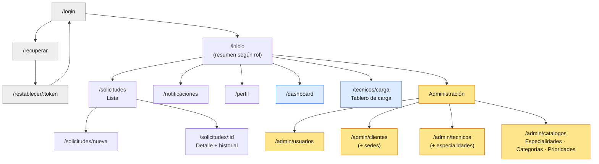

# Mapa del sitio

Una sola aplicación. El menú lateral muestra solo las secciones permitidas para el rol.

Gris: público. Azul: administrador y coordinador. Amarillo: solo administrador. Sin color: todos los roles con sesión.

## Rutas y permisos

| Ruta | Pantalla | Admin | Coordinador | Técnico | Cliente |
|---|---|---|---|---|---|
| `/login` | Inicio de sesión | público | público | público | público |
| `/recuperar` | Pedir restablecimiento | público | público | público | público |
| `/restablecer/:token` | Nueva contraseña | público | público | público | público |
| `/primer-acceso` | Bienvenida y cambio de contraseña temporal | ✔ | ✔ | ✔ | ✔ |
| `/inicio` | Resumen del rol | ✔ | ✔ | ✔ | ✔ |
| `/perfil` | Mi perfil | ✔ | ✔ | ✔ | ✔ |
| `/notificaciones` | Mis notificaciones | ✔ | ✔ | ✔ | ✔ |
| `/solicitudes` | Lista | todas | todas | asignadas a mí | de mi organización |
| `/solicitudes/nueva` | Registrar | – | ✔ elige cliente | – | ✔ |
| `/solicitudes/:id` | Detalle e historial | ver, reabrir | aprobar, asignar, cerrar, reabrir | iniciar, pedir info, resolver | ver, responder, cancelar |
| `/dashboard` | Indicadores | todo | su equipo | – | – |
| `/tecnicos/carga` | Tablero de carga | ✔ | ✔ | – | – |
| `/admin/usuarios` | Usuarios | ✔ | – | – | – |
| `/admin/clientes` | Clientes y sedes | ✔ | – | – | – |
| `/admin/tecnicos` | Técnicos | ✔ | – | – | – |
| `/admin/catalogos` | Catálogos y parámetros | ✔ | – | – | – |

Si un rol entra a una ruta que no le corresponde, la aplicación lo redirige a `/inicio`. El servidor responde 403 de todos modos: el menú oculto no es la protección.

## Contenido de `/inicio` por rol

| Rol | Qué muestra |
|---|---|
| Cliente | Mis solicitudes abiertas, las que esperan mi respuesta, botón "Nueva solicitud" |
| Técnico | Mis asignadas ordenadas por plazo, cuántas vencen hoy |
| Coordinador | Por aprobar, por asignar, por vencer, por cerrar |
| Administrador | Acceso al dashboard y contadores generales |
