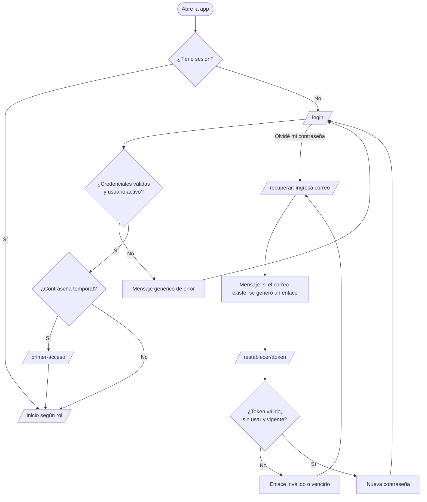
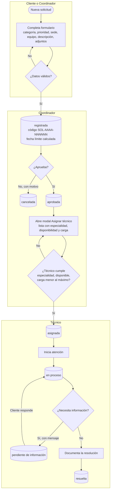
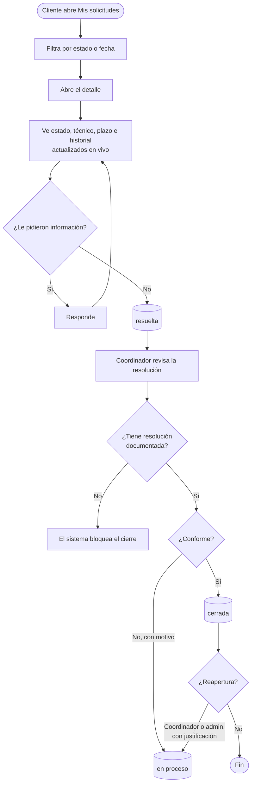
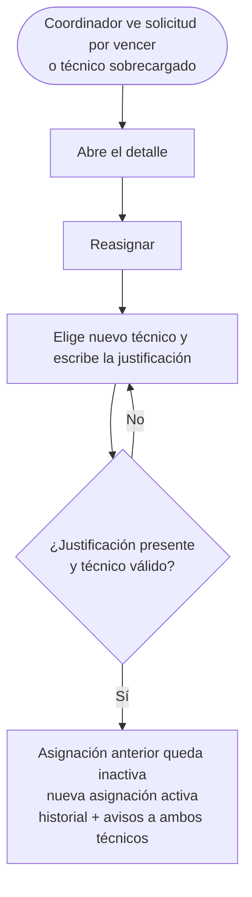
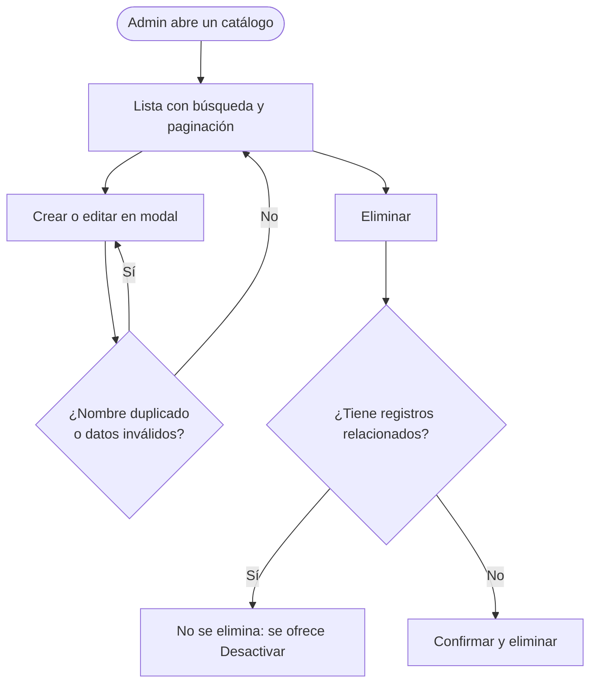
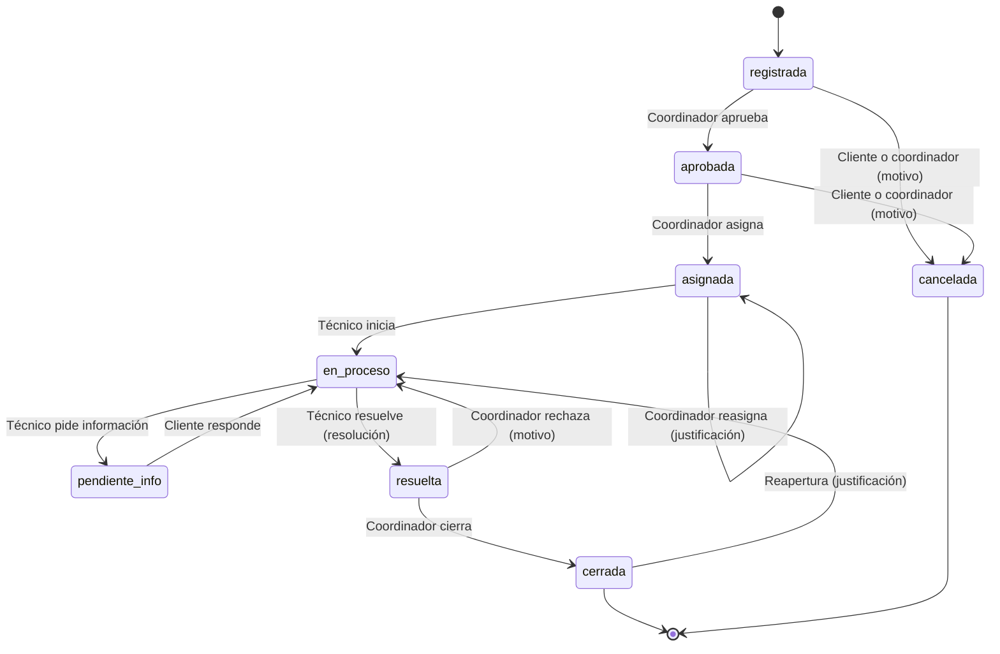

# Flujos de usuario

Los flujos 2 y 3 son los dos recorridos de extremo a extremo que exige el enunciado; cada uno tendrá su prueba E2E.

## 1. Inicio de sesión y recuperación

## 2. Registro → asignación → atención

Cada cambio de estado genera un registro en el historial y una notificación a los interesados.

## 3. Consulta → seguimiento → cierre

## 4. Reasignación justificada

## 5. Administración de catálogos

## Estados de la solicitud vistos desde la interfaz

Los botones de acción del detalle se calculan a partir de este diagrama y del rol; el servidor vuelve a validar cada transición.
