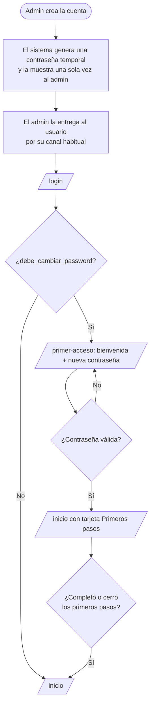

# Onboarding

No hay registro público: el administrador crea cada cuenta. El onboarding es, por eso, **primer acceso + primeros pasos por rol + estados vacíos que enseñan**. No hay tour con globos ni videos: cada paso lleva a una pantalla real.

## 1. Flujo

- Mientras `debe_cambiar_password` sea verdadero, el servidor rechaza todo con 403 `CAMBIO_PASSWORD_REQUERIDO` excepto `GET/PATCH /auth/me` y `POST /auth/logout`. El frontend redirige a `/primer-acceso`, pero quien protege es el servidor.
- Cuando el admin restablece la contraseña de un usuario, la bandera vuelve a verdadero.
- La contraseña temporal no se envía por correo (las notificaciones son solo en la app).

## 2. Pantalla `/primer-acceso`

Tarjeta centrada, igual que el login:

1. Saludo con el nombre y el rol: "Hola, María. Entras como coordinadora."
2. Una línea de lo que hará ese rol en la app (tabla de la sección 3).
3. Nueva contraseña + confirmación, con la regla visible debajo del campo (mínimo 8 caracteres, una letra y un número).
4. Botón principal **Guardar y entrar**. Error por campo; el botón se desactiva mientras se envía.

## 3. Primeros pasos por rol

Tarjeta al inicio de `/inicio`, encima del resumen del rol. Tres pasos como máximo; cada uno es un enlace a la pantalla donde se hace. Un paso se marca hecho **con datos de la API** (por ejemplo, el cliente ya tiene una solicitud), no porque se hizo clic.

| Rol | Qué hace en la app | Paso 1 | Paso 2 | Paso 3 |
|---|---|---|---|---|
| Administrador | Configura el sistema y ve los indicadores | Revisar categorías y plazos por prioridad (`/admin/catalogos`) | Crear técnicos con sus especialidades (`/admin/tecnicos`) | Crear clientes, sedes y sus usuarios (`/admin/clientes`) |
| Coordinador | Aprueba, asigna y vigila los plazos | Ver las solicitudes por aprobar (`/solicitudes?estado=registrada`) | Conocer la carga de los técnicos (`/tecnicos/carga`) | Asignar la primera solicitud (detalle → Asignar) |
| Técnico | Atiende lo que le asignan | Completar el teléfono en el perfil (`/perfil`) | Abrir su primera solicitud asignada (`/solicitudes`) | Registrar avance o resolverla (detalle) |
| Cliente | Registra y sigue sus solicitudes | Completar el teléfono en el perfil (`/perfil`) | Registrar la primera solicitud (`/solicitudes/nueva`) | Ver su estado e historial (detalle) |

- Barra de progreso "1 de 3" (`progress` de shadcn) y botón **Ocultar** (`ghost`).
- Desaparece sola al completar los tres pasos.
- shortcut: "Ocultar" se guarda en `localStorage` por usuario; si se borra el navegador vuelve a aparecer. Pasarlo a una columna de `usuarios` si molesta.

## 4. Estados vacíos que enseñan

Cada lista vacía dice qué falta y ofrece la acción siguiente, según el rol (`empty` de shadcn):

| Pantalla | Rol | Mensaje | Acción |
|---|---|---|---|
| `/solicitudes` | Cliente | Aún no registras solicitudes | Nueva solicitud |
| `/solicitudes` | Técnico | No tienes solicitudes asignadas. Te avisaremos cuando llegue una | – |
| `/solicitudes` | Coordinador | No hay solicitudes por revisar | Registrar en nombre de un cliente |
| `/tecnicos/carga` | Coordinador / admin | Todavía no hay técnicos | Crear técnico (solo admin) |
| `/dashboard` | Admin / coordinador | Aún no hay datos en este periodo | Cambiar rango de fechas |
| `/admin/*` | Admin | Aún no hay registros | Crear el primero |
| `/notificaciones` | Todos | No tienes notificaciones | – |

Con filtros activos el mensaje cambia a "Ningún resultado con estos filtros" y la acción a **Limpiar filtros**.

## 5. Cambios que implica

| Dónde | Cambio |
|---|---|
| `docs/tecnico/02-modelo-datos.md` | `usuarios.debe_cambiar_password boolean NOT NULL DEFAULT true` |
| `docs/tecnico/04-api.md` | `POST /auth/login` devuelve `debeCambiarPassword`; error 403 `CAMBIO_PASSWORD_REQUERIDO`; `POST /usuarios` y el restablecimiento por admin devuelven la contraseña temporal una sola vez |
| `docs/ux/02-sitemap.md` | Ruta `/primer-acceso` |
| Pruebas | Integración: usuario nuevo no puede listar solicitudes hasta cambiar la contraseña |
